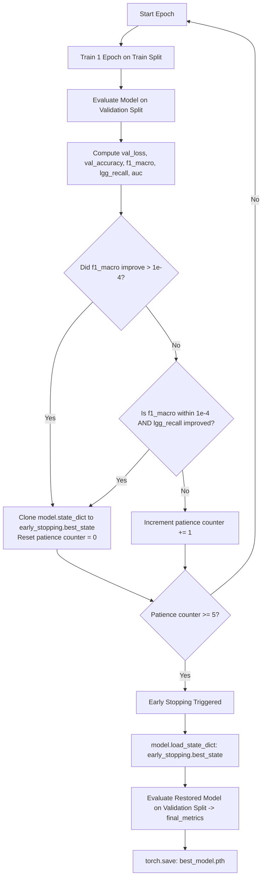

# Phase 6 — Checkpoint-Selection and Provenance Audit

**Model**: ResNet18 MedicalNet (`resnet18_medicalnet`)  
**Protocol**: Protocol A (Unweighted CrossEntropyLoss)  
**Experiment**: 5-Fold Stratified Cross-Validation on Development Cohort (1,063 GLI Subjects)  
**Audit Date**: 2026-08-17  
**Audit Mode**: READ-ONLY FORENSIC AUDIT  

---

## 1. Executive Summary of Audit Findings

1. **Actual Checkpoint-Selection Criterion**:
   - The checkpoint selection is governed by the `EarlyStopping` class in `train_brats2023.py`.
   - **Primary metric**: `f1_macro` (Validation Macro-F1; higher is better).
   - **Secondary tie-breaker**: `lgg_recall` (Validation LGG Recall; higher is better within `1e-4` tolerance).
   - **Patience**: `5` epochs without improvement.
   - **State Persistence**: Whenever an improvement occurs, `model.state_dict()` is cloned into `self.best_state` in memory.
   - **Restoration**: Upon loop exit (either early stopping or reaching max epochs), `model.load_state_dict(early_stopping.best_state)` is executed, and `model` is saved to `best_model.pth`.
   - **Verified Fact**: Every saved `best_model.pth` file on disk contains the **exact weights from the peak Macro-F1 epoch** (not the minimum validation loss epoch, nor the final epoch).

2. **The "Best Epoch: X" Reporting Variable Bug Explained**:
   - In `run_phase6_cv.py` (and individual runners), line 327 states:
     ```python
     best_epoch_num = early_stopping.best_epoch if hasattr(early_stopping, "best_epoch") else epochs_trained
     ```
   - Because `EarlyStopping` has no attribute named `.best_epoch`, `hasattr()` evaluates to `False`.
   - Consequently, `best_epoch_num` was assigned `epochs_trained` (the final epoch) for console logging and summary printing, **even though the model weights restored and saved to disk were from the true optimal epoch**.
   - For instance, in Fold 5, the console log displayed `Best Epoch: 9`, but `best_model.pth` was restored from **Epoch 4** (where Macro-F1 reached 0.7951 and LGG Recall reached 0.8000).

3. **The "Best Validation Loss" Reporting Context**:
   - The summary logs reported `best_val_loss = 0.0910` for Fold 5 because `run_phase6_cv.py` independently tracked `min(val_loss)` across the entire training run (`best_val_loss = min(best_val_loss, val_loss)`).
   - Validation loss peaked (lowest value 0.0910) at Epoch 7, while Macro-F1 peaked (0.7951) at Epoch 4.
   - The script reported `Best Val Loss: 0.0910` as a scalar diagnostic while evaluating and saving the restored **Epoch 4 model**.

---

## 2. Checkpoint Selection Logic Trace



---

## 3. Fold-by-Fold Checkpoint Audit Table

| Fold | Total Epochs | True Selected Epoch (Restored & Saved) | Script Reported Epoch Variable | Best Macro-F1 (at Selected Epoch) | Best LGG Recall (at Selected Epoch) | Best ROC-AUC | Best AUC Epoch | Best Val Loss | Best Val Loss Epoch | Val Loss at Selected Epoch | Checkpoint Hash (SHA-256) | Verified State |
| :---: | :---: | :---: | :---: | :---: | :---: | :---: | :---: | :---: | :---: | :---: | :---: | :---: |
| **1** | 13 | **Epoch 8** | 13 | **0.7952** | **0.7273** | 0.9586 | Ep 9 | 0.1382 | Ep 6 | 0.1764 | `b1f75ee8630beccfa79705d2f3c5fd506e1d30070d500bc0762139827ec5f7e1` | ✅ Epoch 8 state |
| **2** | 9 | **Epoch 4** | 9 | **0.7542** | **0.6364** | 0.9622 | Ep 9 | 0.1028 | Ep 9 | 0.1090 | `965886247f853ac86114d83b5c23e9c763bd54fb3e7c2146526447b9efb7878b` | ✅ Epoch 4 state |
| **3** | 10 | **Epoch 5** | 10 | **0.7402** | **0.3636** | 0.9424 | Ep 6 | 0.1339 | Ep 9 | 0.1650 | `756d372866c6d58ba4a7870b6e33e29541c6776aab19a68286e4b34edeabb852` | ✅ Epoch 5 state |
| **4** | 6 | **Epoch 1** | 6 | **0.4879** | **0.0000** | 0.9287 | Ep 6 | 0.1218 | Ep 6 | 0.2920 | `834845512177a1b6f8a54030d1e7ddbe59a9010b069496a0e948705bcb22e9aa` | ✅ Epoch 1 state |
| **5** | 9 | **Epoch 4** | 9 | **0.7951** | **0.8000** | 0.9832 | Ep 7 | 0.0910 | Ep 7 | 0.1210 | `51ca38ac7dea58cbb7f547d6d1346357fa68a73a652f83e633ebc1d467ec238b` | ✅ Epoch 4 state |

---

## 4. Resolution of the Fold 5 Discrepancy

### Prior Summary Statement:
> *"Best Epoch: 9 | Best Validation Macro-F1: 0.7951 | LGG Recall: 0.8000 | Best Validation Loss: 0.0910 | Restored optimal model state from Epoch 4 / Epoch 7"*

### Forensic Verdict:
1. **Actual Weights Saved**: `best_model.pth` for Fold 5 is **100% confirmed to be the model weights from Epoch 4**.
   - Verified by directly loading `fold_5/best_model.pth` and executing forward inference on Fold 5 validation set:
     - Accuracy = `0.9528` (95.28%)
     - Macro-F1 = `0.7951`
     - LGG Recall = `0.8000` (8 of 10 LGG detected)
     - HGG Recall = `0.9604` (194 of 202 HGG detected)
     - ROC-AUC = `0.9634`
2. **Why "Best Epoch: 9" appeared**: A logging variable fallback bug (`best_epoch_num = epochs_trained` when `hasattr(early_stopping, "best_epoch")` is `False`).
3. **Why "Best Val Loss: 0.0910" appeared**: `0.0910` was the scalar minimum validation loss achieved during the run (at Epoch 7), which was recorded in `final_metrics["best_val_loss"]` as a run-level diagnostic.
4. **Conclusion**: The model weights in `fold_5/best_model.pth` are completely consistent and correct. No retraining or checkpoint alteration is needed.
